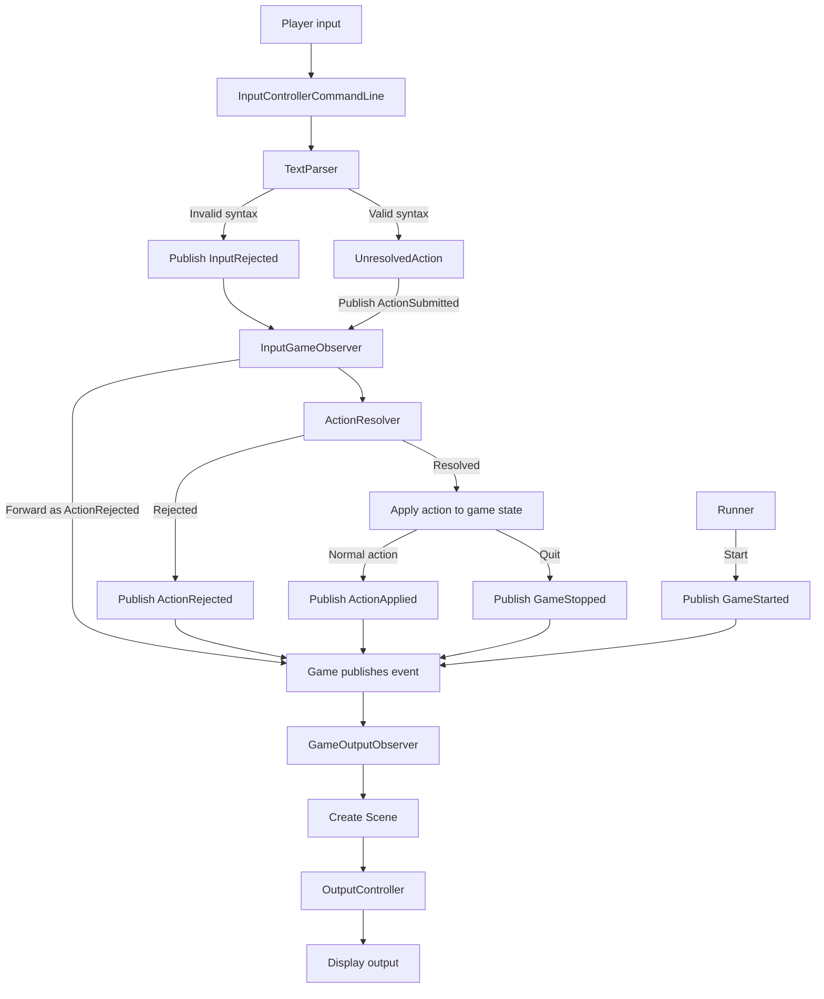

# Architecture

Calcifer is a small text-adventure engine organized around a UI-independent game model and an observer-driven input-to-game-to-output pipeline. The current concrete interface is command-line text; game content is defined separately in YAML.

## Runtime composition

[`calcifer/runner.py`](calcifer/runner.py) is the composition root. It loads verbs, items, characters, and locations from the selected data package, creates the game and command-line controllers, and connects the input and output observers. It selects the protagonist, marks the game as running, and starts the input loop.

## Action and output flow

1. [`ui/controllers.py`](ui/controllers.py) defines abstract input and output controller interfaces, along with command-line implementations. The input controller uses [`ui/text/parser.py`](ui/text/parser.py) to parse typed text into an `UnresolvedAction` and publishes it as `ActionSubmitted`. Parse failures are published as `InputRejected`; the controller does not render them.
2. [`engine/input_game_observer.py`](engine/input_game_observer.py) forwards input rejections to the game as `ActionRejected`, or asks [`engine/action_resolver.py`](engine/action_resolver.py) to resolve a submitted action against the current game context. The resolver looks up named objects through the game's container factory and rejects actions that are invalid for the current context.
3. The observer applies a resolved action to [`engine/game.py`](engine/game.py), updating game state such as the protagonist's location or inventory, then publishes `ActionApplied`. Invalid actions publish `ActionRejected` instead.
4. The game publishes `GameStarted` and `GameStopped` lifecycle events when it starts or stops. [`engine/game_output_observer.py`](engine/game_output_observer.py) handles these and action events, maps them to `Scene` objects, and sends them to the output controller for display.

Observers receive event objects directly rather than inspecting a mutable “latest event” field. The action flow uses explicit `ActionSubmitted`, `ActionApplied`, and `ActionRejected` events, along with `GameStarted` and `GameStopped` lifecycle events. Notifications are synchronous; `ObservedAttribute` remains for other observed model attributes and publishes an `AttributeChanged` event.

## Main responsibilities

- **UI:** [`ui/`](ui/) owns command parsing and controller interfaces. The parser normalizes syntax into actions; game-state validation happens later in the engine.
- **Engine:** [`engine/`](engine/) owns game state, action resolution, action application, container selection, and event-to-output behavior.
- **World:** [`world/`](world/) defines characters, items and inventories, locations and exits, verbs, and scenes. [`world/mappings.py`](world/mappings.py) constructs these objects from YAML definitions.
- **Content:** [`data/`](data/) contains the default YAML definitions. [`data/test/`](data/test/) provides alternate definitions for tests.
- **Observer support:** [`pattern/observer.py`](pattern/observer.py) provides the common subject, observer, and observed-attribute primitives.

## Content and presentation

YAML files define verbs, characters, locations, and items independently of the engine. Mapping classes resolve references between definitions, such as a location exit's destination or an inventory's items. The engine works with these in-memory objects rather than reading YAML during play.

The controller interfaces are intended to keep game logic independent of the input/output medium. In the current implementation, however, the concrete controllers are command-line based and [`world/scene.py`](world/scene.py) represents a scene as text; other interfaces would need their own controllers and any richer presentation model they require.

## Tests and decisions

Tests are divided among engine, parser, runner, UI, world, YAML-mapping snapshots, and command-line functional scenarios. Run them with `uv run pytest` (see [`README.md`](README.md)).

The accepted architectural decisions are documented in [`doc/adr/`](doc/adr/). In particular, ADRs 2 through 6 describe the controller boundary, observer flow, YAML-loaded world objects, and action validation in the input-game observer.
